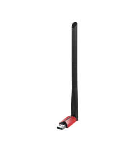

# aic8800-linux-driver

TP-LINK TL-XDN6000H 免驱版 V1.0 / AIC8800DC USB 无线网卡 Linux 驱动，基于厂商源码，包含内核兼容补丁和 DKMS 自动重编译支持。



## 推荐安装：单文件自动安装包

从发布附件或自行构建的 `dist/` 中取得 `aic8800-installer-1.3.1.run`，复制到目标机器后运行：

```bash
bash aic8800-installer-1.3.1.run --yes
```

普通用户运行时会通过 sudo 提权；`--yes` 自动确认 APT 安装，sudo 仍遵循系统的密码要求。不加 `--yes` 可检查 APT 提示后确认。

安装器会检查当前内核，自动下载缺失的 DKMS、编译工具、匹配的内核头文件和 GCC，然后在一次 APT 事务中安装/升级驱动，避免旧版本半配置状态阻塞依赖安装。它不会在 dpkg 维护脚本里嵌套运行 APT。

完成后重启，或重新插拔 USB 网卡。安装脚本不强制卸载正在使用的模块；旧版 1.2.0/1.3.0 自带的卸载脚本在升级时仍可能卸载旧模块，因此首次迁移请使用有线网络或其他连接。Secure Boot 开启时，DKMS 会使用系统签名机制，未信任的签名密钥需要在重启时通过 MOK 界面确认；安装包不能绕过固件确认。

仅解包、不安装：

```bash
bash aic8800-installer-1.3.1.run --extract ./aic8800-bundle
```

包中包含标准 `.deb`、`install.sh`、使用说明、改动与验证记录及厂商文档。校验文件 `dist/SHA256SUMS` 对应本次生成的两个安装文件。

## 支持范围与要求

- Debian/Ubuntu 及兼容的 APT/dpkg 发行版，GCC 编译的 Linux 内核。源码包为 `Architecture: all`，在目标机器本地编译；不承诺所有架构、所有发行版和未来内核都已验证。
- 必须是此厂商驱动支持的 USB 设备；不能因为芯片同属 AIC8800 系列就认定其他型号兼容。
- 自动下载依赖需要可用网络和正确的软件源。首次安装无线驱动时，请用有线网络、手机 USB 网络共享等方式联网。
- 当前运行内核必须有完全匹配的、已准备好的头文件。若软件源已移除该内核，安装器会明确退出；请启用对应软件源，或先启动仍有头文件的内核。不会用其他版本头文件替代。
- Clang 内核需要另行配置 LLVM 工具链，当前自动安装入口会明确拒绝。未来内核 API 变化仍可能需要源码适配；错误日志会保留。
- 依赖已安装且内核头文件可用时可离线安装；离线时缺失的依赖无法自动取得。

## 标准 Deb 安装

已有匹配内核头文件和 GCC 时，可交给 APT 自动处理包中声明的通用依赖：

```bash
sudo apt install ./aic8800fdrvpackage_1.3.1_dkms_all.deb
```

需要自动判断并下载当前内核头文件和对应 GCC 时，使用 `.run`，或将 `install.sh` 和 `.deb` 放在一起：

```bash
bash install.sh --yes ./aic8800fdrvpackage_1.3.1_dkms_all.deb
```

`dpkg -i` 本身不下载依赖，不作为推荐入口。驱动安装到 DKMS 后会在内核更新时自动重编译；请同步安装新内核头文件和编译器。如果升级后缺少这些项，可重新运行自动安装器。

## 构建与验证

构建主机需要 Bash、dpkg-deb、tar 和 coreutils，不需要 root：

```bash
./build.sh
python3 tests/test_packaging.py
```

输出保存在 `dist/`，不会删除旧版本安装包；构建使用临时目录，清除打包副本中的 `.o/.ko` 等产物，使用 root 文件所有权。`DEBIAN/control` 是构建时的版本来源，DKMS 配置及维护脚本随打包自动同步。

历史问题与本次验证记录见 [CHANGELOG.md](CHANGELOG.md) 和 [docs/validation-1.3.1.md](docs/validation-1.3.1.md)。

## 排错与卸载

```bash
uname -r
dkms status
sudo cat /var/lib/dkms/aic8800/1.3.1/build/make.log
modinfo aic8800_fdrv
sudo apt remove aic8800fdrvpackage
```

成功构建后的日志通常位于 `/var/lib/dkms/aic8800/1.3.1/<kernel>/<arch>/log/make.log`。删除软件包不会主动卸载内存中的模块，重启后生效。

如果提示找不到 `aic_load_fw.ko`，检查 `dkms.conf` 中两个 `BUILT_MODULE_LOCATION` 是否分别为 `aic_load_fw/` 和 `aic8800_fdrv/`。1.3.1 已修复旧包遗漏此配置的问题。

## 来源与历史

本项目由 [TP-LINK 厂商驱动](https://resource.tp-link.com.cn/pc/docCenter/showDoc?productId=3217&type=DRIVER&id=1737698106348416) 改版。最初为缓解安装时高负载限制编译并行数；当前 DKMS 构建固定使用四个任务，并保留原来的平台配置。历史编译错误示例保留在 `bug.txt`。
